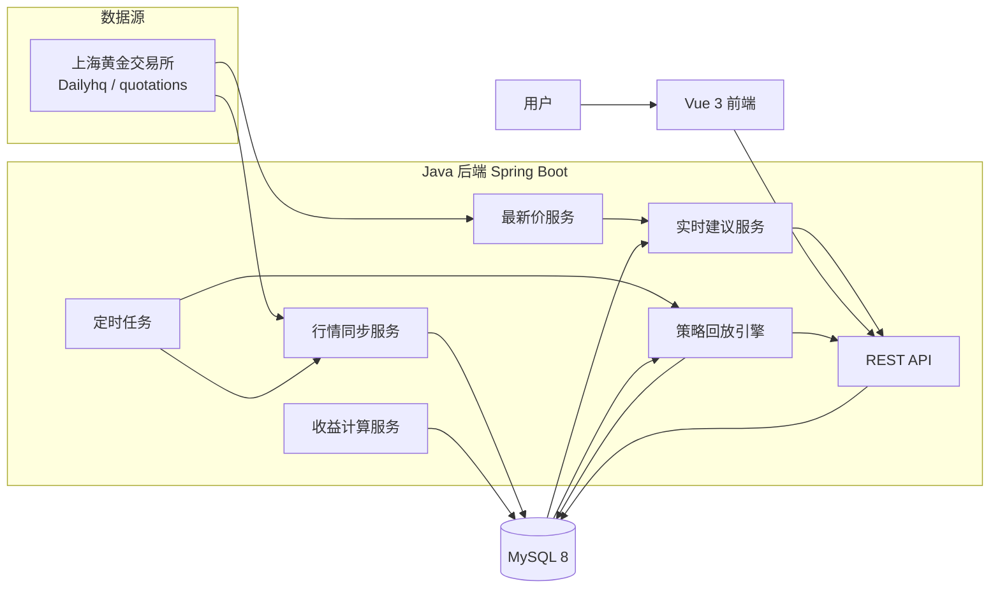
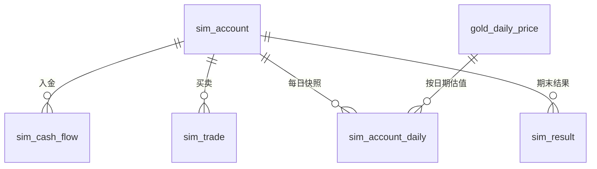
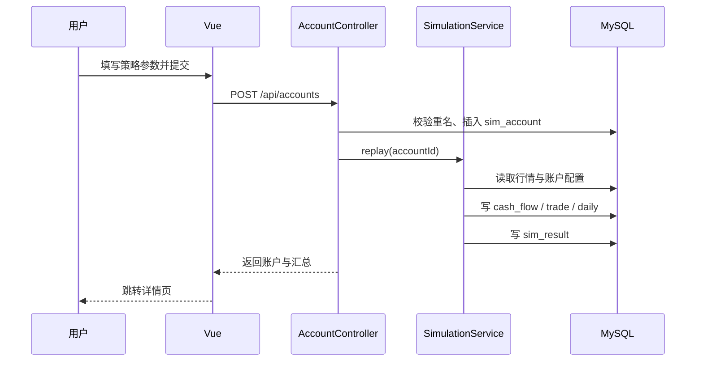
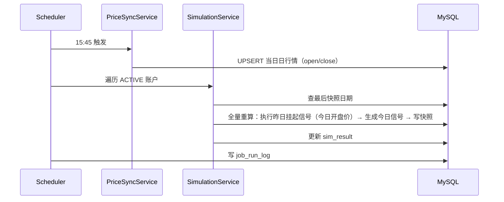
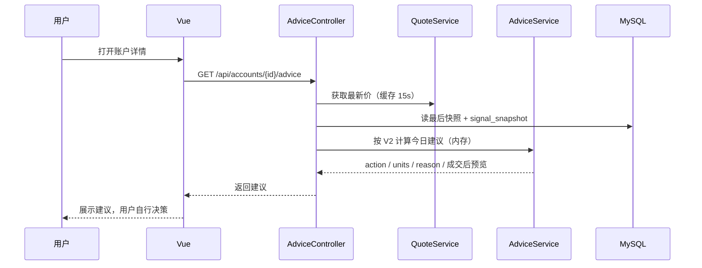

# 黄金投资策略对比系统 — 详细设计方案

> 目标：在同一套黄金行情下，对比「每个交易日定投 50 元」「原始跌买补仓 V1」「修订跌买补仓 V2」三种策略的最终收益；页面按最新价给出 V2 的买入/观望建议，由你手动决策。
> 技术栈：Java 17 + Spring Boot 3 + MySQL 8 + Vue 3。
> 数据源：上海黄金交易所 Au99.99（元/克）日行情与分时最新价。
> 规则版本：V2 为默认；V1 保留用于对比，不删除。

---

## 1. 需求拆解

| 需求 | 落地方式 |
| --- | --- |
| 每日定投 50 元 | 每个交易日外部入金 50 元，按当日成交价买入 Au99.99 |
| 按你的方式买入 | 跌买补仓账户：V1=原始规则，V2=平盘中性 + 跌破阈值 + 补买上限 |
| 三种策略对比 | 同区间、同资金节奏、同费率下对比定投、V1、V2 的净值、XIRR、净收益、最大回撤 |
| 规则版本 | `rule_version` 选择 V1/V2，共用同一套回放引擎 |
| 页面实时建议 | 按最新价计算 V2 建议（买入份数/金额/原因/成交后预览），只展示不自动下单 |
| 买卖数据落库 | `sim_trade` 记录每笔价格、克数、金额、手续费、信号快照 |
| 每日买卖金额落库 | `sim_account_daily` 记录每日买入金额、卖出金额、累计金额、权益 |
| 最终收益落库 | `sim_result` 记录期末本金、市值、净收益、XIRR、回撤、交易次数 |
| 可创建新账户对比 | 支持无限创建模拟账户，按策略类型和参数独立回放，多选对比 |

---

## 2. 默认业务口径（先定规则，再写代码）

以下为默认值，均做成账户级可配置项：

| 项目 | 默认口径 | 说明 |
| --- | --- | --- |
| 标的 | 上金所 Au99.99 | 单位：元/克，保留 2 位小数 |
| 交易日 | 日行情表中出现的日期 | 周末、节假日不交易，也不入金 |
| 规则版本 | V2（默认），V1 保留对比 | V1=原始规则；V2=平盘中性 + 跌破阈值 + 补买上限 |
| 定投账户 | 每交易日入金 50 元并立即买入 | 买入金额 = 50 元（扣除手续费后全部买金） |
| 规则账户 | 每交易日同样入金 50 元 | 按 V1/V2 规则决定当日买 0 份、1 份或补买份数 |
| 每份金额 | 50 元（可配） | 规则账户的买入单位，未买日的 50 元留存为现金 |
| 卖出规则 | 本策略不主动卖出 | 页面卖出建议固定为「无」，仅保留「清仓结算」 |
| 回测成交价 | T 日收盘决策，T+1 开盘成交 | 避免用当日收盘价决策又按同一收盘价成交的执行偏差 |
| 实时建议 | 最新价 vs 昨收/未买均价 | 盘中预判，不自动下单；实际决策与成交由你完成 |
| 手续费 | 0（已确认） | 买卖双向按成交金额比例收取，默认 0 |
| 初始本金 | 默认 0，可配 | 在起始日作为一笔外部入金 |
| 期末估值 | 最后一个交易日收盘价 | 另提供「清仓结算」按钮，按期末价卖出全部持仓 |
| 收益对比主指标 | XIRR（资金加权年化） | 同时展示净收益、简单收益率、最大回撤 |

**关键假设：**

1. 回测时，T 日只与 T-1 日收盘价比较，T 日收盘决策、T+1 日开盘成交；实时建议用最新价对「今日」做盘中预判，两者不混用。
2. V2 为默认规则；V1 仅用于对比，同一套回放引擎通过 `rule_version` 切换。
3. V2 中平盘为中性：不买、不计入未买日、不清空未买日；只有真正上涨才加入未买日。
4. V2 中浅跌破（未达到 `dipThreshold`）只买 1 份并保留未买日；深跌破才补买，份数封顶 `maxCatchupUnits`。
5. 定投、V1、V2 使用完全相同的入金节奏、费率和区间，保证对比公平。
6. 规则账户只买不卖、不做空、不加杠杆；现金不足以补买时按可用现金买入，并记录实际份数。
7. 每个交易日策略最多一笔买入；清仓结算作为独立交易记录，不覆盖当日策略交易。
8. 页面建议只是规则计算结果，不构成投资建议；不接券商、不自动下单，实际买卖由你决定。

---

## 3. 系统架构



模块职责：

- **行情同步**：拉取 SGE 全量日行情，按日期 UPSERT。
- **最新价服务**：缓存 `quotations` 最新价 15 秒，返回价格、行情时间与延迟标识。
- **策略回放**：按交易日逐日推进，计算信号、执行买卖、更新现金与持仓、写每日快照。
- **实时建议**：读取账户最后快照与规则状态，用最新价计算 V2 建议；只读，不推进状态、不落交易。
- **收益计算**：权益、净收益、XIRR、单位净值、最大回撤、资金利用率。
- **定时任务**：收盘后同步行情并推进所有活跃账户；支持手动重算。
- **REST API**：账户、行情、最新价、实时建议、回放、对比、明细、任务日志。
- **Vue 前端**：今日建议卡、账户管理、盈亏对比、走势图、交易明细、行情数据页。

---

## 4. 数据模型

数据库：`gold_panel`，字符集 `utf8mb4`，金额统一 `DECIMAL(18,4)`，价格 `DECIMAL(10,4)`，克数 `DECIMAL(16,4)`。

### 4.1 行情表

```sql
CREATE TABLE gold_daily_price (
  id            BIGINT UNSIGNED NOT NULL AUTO_INCREMENT,
  trade_date    DATE            NOT NULL COMMENT '交易日',
  open_price    DECIMAL(10,4)   NOT NULL,
  close_price   DECIMAL(10,4)   NOT NULL COMMENT '当日成交价/收盘价',
  low_price     DECIMAL(10,4)   NOT NULL,
  high_price    DECIMAL(10,4)   NOT NULL,
  source        VARCHAR(32)     NOT NULL DEFAULT 'SGE',
  created_at    DATETIME        NOT NULL DEFAULT CURRENT_TIMESTAMP,
  updated_at    DATETIME        NOT NULL DEFAULT CURRENT_TIMESTAMP ON UPDATE CURRENT_TIMESTAMP,
  PRIMARY KEY (id),
  UNIQUE KEY uk_trade_date (trade_date)
) ENGINE=InnoDB COMMENT='Au99.99 日行情';
```

说明：`close_price` 就是本系统使用的「历史成交价」。同步时全量拉取后批量 UPSERT，天然幂等。

### 4.2 模拟账户表

```sql
CREATE TABLE sim_account (
  id               BIGINT UNSIGNED NOT NULL AUTO_INCREMENT,
  name             VARCHAR(64)     NOT NULL COMMENT '账户名称',
  strategy_type    VARCHAR(16)     NOT NULL COMMENT 'DCA=每日定投, DIP_BUY=跌买补仓',
  rule_version     VARCHAR(8)      NOT NULL DEFAULT 'V2' COMMENT 'V1=原始规则, V2=修订规则',
  initial_capital  DECIMAL(18,4)   NOT NULL DEFAULT 0 COMMENT '起始日一次性入金',
  daily_deposit    DECIMAL(18,4)   NOT NULL DEFAULT 50 COMMENT '每交易日入金',
  start_date       DATE            NOT NULL,
  end_date         DATE            NULL COMMENT '为空表示持续到最新交易日',
  fee_rate         DECIMAL(10,6)   NOT NULL DEFAULT 0 COMMENT '手续费率，0.0002=0.02%',
  rule_config      JSON            NULL COMMENT '规则参数',
  status           VARCHAR(16)     NOT NULL DEFAULT 'ACTIVE' COMMENT 'ACTIVE/PAUSED/ARCHIVED',
  remark           VARCHAR(255)    NULL,
  created_at       DATETIME        NOT NULL DEFAULT CURRENT_TIMESTAMP,
  updated_at       DATETIME        NOT NULL DEFAULT CURRENT_TIMESTAMP ON UPDATE CURRENT_TIMESTAMP,
  PRIMARY KEY (id),
  UNIQUE KEY uk_name (name),
  KEY idx_status (status)
) ENGINE=InnoDB COMMENT='模拟账户';
```

`rule_config` 示例（V2，默认）：

```json
{
  "unitAmount": 50,
  "flatHandling": "NEUTRAL",
  "dipThreshold": 0.01,
  "maxCatchupUnits": 3,
  "executionMode": "T_PLUS_1_OPEN"
}
```

V1 对比账户：

```json
{
  "unitAmount": 50,
  "flatHandling": "AS_UP",
  "executionMode": "T_PLUS_1_OPEN"
}
```

字段说明：

- `flatHandling`：`NEUTRAL`=平盘不买、不计入未买日；`AS_UP`=平盘按上涨处理并计入未买日（V1）。
- `dipThreshold`：补买阈值，默认 `0.01`，表示现价需低于未买均价 1% 才触发补买。
- `maxCatchupUnits`：单日补买总份数上限，默认 3 份，含当日 1 份。
- `executionMode`：回测成交模式，默认 `T_PLUS_1_OPEN`；`T_PLUS_1_CLOSE`、`SAME_CLOSE` 仅用于对照旧口径。

### 4.3 外部资金流水表

```sql
CREATE TABLE sim_cash_flow (
  id          BIGINT UNSIGNED NOT NULL AUTO_INCREMENT,
  account_id  BIGINT UNSIGNED NOT NULL,
  flow_date   DATE            NOT NULL,
  flow_type   VARCHAR(24)     NOT NULL COMMENT 'INITIAL/DAILY_DEPOSIT/WITHDRAW',
  amount      DECIMAL(18,4)   NOT NULL COMMENT '正数入金，负数出金',
  memo        VARCHAR(128)    NULL,
  created_at  DATETIME        NOT NULL DEFAULT CURRENT_TIMESTAMP,
  PRIMARY KEY (id),
  UNIQUE KEY uk_acc_date_type (account_id, flow_date, flow_type),
  KEY idx_acc_date (account_id, flow_date),
  CONSTRAINT fk_flow_account FOREIGN KEY (account_id)
    REFERENCES sim_account (id) ON DELETE CASCADE
) ENGINE=InnoDB COMMENT='外部入金/出金流水，用于 XIRR';
```

注意：卖出回款是账户内部资金，不写入本表，避免虚增收益。

### 4.4 交易流水表（买卖金额落库）

```sql
CREATE TABLE sim_trade (
  id               BIGINT UNSIGNED NOT NULL AUTO_INCREMENT,
  account_id       BIGINT UNSIGNED NOT NULL,
  trade_date       DATE            NOT NULL COMMENT '成交日',
  signal_date      DATE            NULL COMMENT '信号日；T+1 成交时早于 trade_date',
  source           VARCHAR(16)     NOT NULL DEFAULT 'DAILY' COMMENT 'DAILY=策略日交易, SETTLE=清仓结算',
  side             VARCHAR(8)      NOT NULL COMMENT 'BUY/SELL',
  price            DECIMAL(10,4)   NOT NULL COMMENT '成交价',
  units            DECIMAL(8,2)    NOT NULL DEFAULT 0 COMMENT '买入份数，1份=unitAmount；卖出为0',
  grams            DECIMAL(16,4)   NOT NULL COMMENT '成交克数',
  amount           DECIMAL(18,4)   NOT NULL COMMENT '成交金额=price*grams',
  fee              DECIMAL(18,4)   NOT NULL DEFAULT 0 COMMENT '手续费',
  cash_after       DECIMAL(18,4)   NOT NULL COMMENT '交易后现金',
  grams_after      DECIMAL(16,4)   NOT NULL COMMENT '交易后持仓克数',
  signal_snapshot  JSON            NULL COMMENT '信号快照',
  created_at       DATETIME        NOT NULL DEFAULT CURRENT_TIMESTAMP,
  PRIMARY KEY (id),
  UNIQUE KEY uk_acc_date_source (account_id, trade_date, source),
  KEY idx_acc_date_side (account_id, trade_date, side),
  CONSTRAINT fk_trade_account FOREIGN KEY (account_id)
    REFERENCES sim_account (id) ON DELETE CASCADE
) ENGINE=InnoDB COMMENT='买卖流水';
```

`signal_snapshot` 示例：

```json
{
  "ruleVersion": "V2",
  "price": 104.0,
  "prevPrice": 108.0,
  "changePct": -3.70,
  "skippedDays": 2,
  "skippedAvg": 107.5,
  "dipPct": -3.26,
  "dipThreshold": 0.01,
  "belowThreshold": true,
  "action": "CATCHUP",
  "expectedUnits": 3,
  "actualUnits": 3,
  "maxCatchupUnits": 3,
  "reason": "price 3.26% below skipped average, catch up 2 skipped days + today, capped at 3"
}
```

### 4.5 每日账户快照表（每日买卖金额落库）

```sql
CREATE TABLE sim_account_daily (
  id                     BIGINT UNSIGNED NOT NULL AUTO_INCREMENT,
  account_id             BIGINT UNSIGNED NOT NULL,
  trade_date             DATE            NOT NULL,
  price                  DECIMAL(10,4)   NOT NULL COMMENT '当日收盘价',
  cash                   DECIMAL(18,4)   NOT NULL,
  grams                  DECIMAL(16,4)   NOT NULL,
  market_value           DECIMAL(18,4)   NOT NULL COMMENT '持仓市值',
  equity                 DECIMAL(18,4)   NOT NULL COMMENT '现金+市值',
  total_deposit          DECIMAL(18,4)   NOT NULL COMMENT '累计外部入金',
  day_buy_amount         DECIMAL(18,4)   NOT NULL DEFAULT 0 COMMENT '当日买入金额',
  day_sell_amount        DECIMAL(18,4)   NOT NULL DEFAULT 0 COMMENT '当日卖出金额',
  cumulative_buy_amount  DECIMAL(18,4)   NOT NULL DEFAULT 0,
  cumulative_sell_amount DECIMAL(18,4)   NOT NULL DEFAULT 0,
  signal_type            VARCHAR(8)      NULL COMMENT '当日收盘产生的信号：BUY/CATCHUP/SKIP；成交在下一交易日',
  signal_snapshot        JSON            NULL COMMENT '当日收盘产生的完整信号，供次日实时建议使用',
  skipped_days           INT             NOT NULL DEFAULT 0 COMMENT '未买上涨日天数',
  skipped_avg            DECIMAL(10,4)   NULL COMMENT '未买日均价',
  skipped_prices         JSON            NULL COMMENT '未买日收盘价列表，供建议与审计使用',
  nav                    DECIMAL(18,8)   NOT NULL DEFAULT 1 COMMENT '单位净值',
  drawdown               DECIMAL(12,8)   NOT NULL DEFAULT 0 COMMENT '相对净值峰值回撤',
  created_at             DATETIME        NOT NULL DEFAULT CURRENT_TIMESTAMP,
  PRIMARY KEY (id),
  UNIQUE KEY uk_acc_date (account_id, trade_date),
  KEY idx_acc_date (account_id, trade_date),
  CONSTRAINT fk_daily_account FOREIGN KEY (account_id)
    REFERENCES sim_account (id) ON DELETE CASCADE
) ENGINE=InnoDB COMMENT='每日账户快照';
```

这张表是收益曲线、每日买卖金额、回撤的直接数据源。

### 4.6 期末结果表（最终收益落库）

```sql
CREATE TABLE sim_result (
  id                    BIGINT UNSIGNED NOT NULL AUTO_INCREMENT,
  account_id            BIGINT UNSIGNED NOT NULL,
  period_start          DATE            NOT NULL,
  period_end            DATE            NOT NULL,
  total_deposit         DECIMAL(18,4)   NOT NULL,
  total_buy_amount      DECIMAL(18,4)   NOT NULL,
  total_sell_amount     DECIMAL(18,4)   NOT NULL,
  total_buy_grams       DECIMAL(16,4)   NOT NULL,
  total_sell_grams      DECIMAL(16,4)   NOT NULL,
  final_cash            DECIMAL(18,4)   NOT NULL,
  final_grams           DECIMAL(16,4)   NOT NULL,
  final_price           DECIMAL(10,4)   NOT NULL,
  final_equity          DECIMAL(18,4)   NOT NULL,
  net_profit            DECIMAL(18,4)   NOT NULL,
  simple_return         DECIMAL(12,8)   NOT NULL,
  xirr                  DECIMAL(12,8)   NULL,
  max_drawdown          DECIMAL(12,8)   NOT NULL,
  capital_utilization   DECIMAL(12,8)   NOT NULL COMMENT '累计买入/累计入金',
  trade_count           INT             NOT NULL DEFAULT 0,
  buy_count             INT             NOT NULL DEFAULT 0,
  sell_count            INT             NOT NULL DEFAULT 0,
  settled               TINYINT(1)      NOT NULL DEFAULT 0 COMMENT '是否已清仓结算',
  calculated_at         DATETIME        NOT NULL DEFAULT CURRENT_TIMESTAMP,
  PRIMARY KEY (id),
  UNIQUE KEY uk_acc_period (account_id, period_start, period_end),
  CONSTRAINT fk_result_account FOREIGN KEY (account_id)
    REFERENCES sim_account (id) ON DELETE CASCADE
) ENGINE=InnoDB COMMENT='期末收益结果';
```

### 4.7 任务日志表

```sql
CREATE TABLE job_run_log (
  id           BIGINT UNSIGNED NOT NULL AUTO_INCREMENT,
  job_type     VARCHAR(24)     NOT NULL COMMENT 'PRICE_SYNC/DAILY_SIM',
  run_date     DATE            NOT NULL,
  status       VARCHAR(16)     NOT NULL COMMENT 'RUNNING/SUCCESS/FAILED',
  message      TEXT            NULL,
  started_at   DATETIME        NOT NULL,
  finished_at  DATETIME        NULL,
  PRIMARY KEY (id),
  KEY idx_type_date (job_type, run_date)
) ENGINE=InnoDB COMMENT='任务执行日志';
```

### 4.8 表关系



---

## 5. 核心算法

### 5.1 价格方向与未买日

设 T 日收盘价为 `P_t`，T-1 日为 `P_{t-1}`：

```text
上涨：P_t > P_{t-1}
下跌：P_t < P_{t-1}
平盘：P_t = P_{t-1}（V1 按上涨处理，V2 中性）
```

- `skippedPrices`：自上次清空之后，被跳过的上涨日收盘价集合；V1 还包含平盘日，V2 不包含。
- `skippedDays`：`skippedPrices` 的长度。
- `skippedAvg`：`skippedPrices` 的算术平均值；V2 的补买阈值在此基础上计算。

### 5.2 买入规则：V1 原始版与 V2 修订版

#### 5.2.1 V1（原始规则，保留对比）

每个交易日按以下状态机执行：

```text
账户首个交易日：
    买入 1 份

之后每个交易日：
    若 P_t >= P_{t-1}（上涨/平盘）：
        不买入；把 P_t 加入 skippedPrices
    若 P_t < P_{t-1}（下跌）：
        若 skippedPrices 为空：
            买入 1 份
        否则：
            skippedAvg = avg(skippedPrices)
            若 P_t >= skippedAvg：
                买入 1 份
            否则：
                买入 skippedDays + 1 份
            清空 skippedPrices
```

- 平盘按上涨处理，计入未买日。
- 任意下跌买入后都清空 `skippedPrices`。
- 没有跌破幅度阈值，也没有补买份数上限。

#### 5.2.2 V2（默认规则）

V2 保留「涨了停、跌了买、跌破未买均价补买」的主干，只修三个洞：

```text
账户首个交易日：
    买入 1 份

之后每个交易日：
    若 P_t > P_{t-1}（上涨）：
        不买入；把 P_t 加入 skippedPrices

    若 P_t = P_{t-1}（平盘）：
        不买入；不计入 skippedPrices，也不清空 skippedPrices

    若 P_t < P_{t-1}（下跌）：
        baseUnits = 1
        若 skippedPrices 非空：
            skippedAvg = avg(skippedPrices)
            dipPct = (P_t - skippedAvg) / skippedAvg
            若 dipPct <= -dipThreshold：
                units = min(1 + skippedDays, maxCatchupUnits)
                清空 skippedPrices
            否则：
                units = baseUnits
                # 浅跌破：只买 1 份，保留 skippedPrices，等更深跌幅再补
        否则：
            units = baseUnits
        执行买入 units 份（受现金约束）
```

- 1 份 = `unitAmount`，默认 50 元。
- `dipThreshold` 默认 `0.01`（1%）；`maxCatchupUnits` 默认 `3`，含当日 1 份。
- 浅跌破只买 1 份并保留未买日，避免「0.01 元小跌把补买额度用光」。
- 深跌破补买 `min(1 + skippedDays, maxCatchupUnits)` 份，避免长期上涨后一次性买 n+1 份。
- 平盘不计入未买日，避免横盘越久、微跌补买越大。
- 连续下跌时 `skippedPrices` 为空，每天买 1 份，对应「再下跌就正常买」。
- 「第三日下跌买两日」在 V2 下仍然成立：第 2 日上涨跳过 1 天，第 3 日下跌且跌破 1% 时，买 `min(2, 3)=2` 份。
- 价格等于均价或跌幅不足 1%：只买 1 份，保留未买日。
- 规则账户只买不卖；期末可选清仓结算。

#### 5.2.3 V1 与 V2 的差异

| 场景 | V1 | V2 |
| --- | --- | --- |
| 平盘 | 计入未买日 | 中性，不计入 |
| 0.01 元小跌破 | 可能买 n+1 份 | 只买 1 份，保留未买日 |
| 跌破均价 2% | 买 n+1 份，无上限 | 买 min(n+1, 3) 份 |
| 浅跌破后的深跌破 | 未买日已被清空，只买 1 份 | 未买日保留，仍可补买 |
| 长期上涨后回调 | 可能一次买很多份 | 最多 3 份 |

定投账户忽略该规则，每个交易日固定买入 1 份（50 元）。

### 5.3 交易与资金更新

**回测每日顺序**：入金 → 用当日收盘价产生信号 → 下一交易日开盘按信号成交 → 记录快照。

- 首个交易日按当日收盘价买入 1 份，作为初始化。
- 之后 T 日收盘产生信号，T+1 日开盘按 `open_price` 成交；`sim_trade.trade_date` 记 T+1，`signal_date` 记 T。
- 区间最后一个交易日产生的信号不执行，避免没有下一交易日。

买入：

```text
计划买入金额 = units * unitAmount   # units 为 0、1 或 min(1+skippedDays, maxCatchupUnits)
可买克数 = floor4(计划买入金额 / (price * (1 + feeRate)))
amount   = round4(grams * price)
fee      = round4(amount * feeRate)
cash_after = cash - amount - fee
grams_after = grams + 买入克数
```

> 回测中 `price` 取 T+1 开盘价；实时建议中 `price` 取最新价。为了聚焦信号与资金变化，附录示例统一按当日收盘价演示，不用于替代回测数字。

卖出（仅清仓结算）：

```text
卖出克数 = floor4(当前全部持仓)
amount   = round4(卖出克数 * price)
fee      = round4(amount * feeRate)
cash_after = cash + amount - fee
grams_after = grams - 卖出克数
```

约束：

- 现金、持仓、克数不允许为负。
- `units = 0` 时不产生交易。
- 每笔交易写入 `sim_trade`（含 `signal_date`、`units`、金额、克数、信号快照），同时更新成交日 `sim_account_daily` 的 `day_buy_amount` / `day_sell_amount`。
- V2 浅跌破只买 1 份并保留 `skippedPrices`；深跌破补买后清空 `skippedPrices`。
- 规则账户的卖出只发生在清仓结算，`source=SETTLE`。
- 实时建议只计算、不写 `sim_trade`、不改 `sim_account_daily`。

### 5.4 收益指标

| 指标 | 公式 |
| --- | --- |
| 持仓市值 | `grams * final_price` |
| 期末权益 | `cash + market_value` |
| 累计入金 | `sum(sim_cash_flow.amount)` |
| 净收益 | `final_equity - total_deposit` |
| 简单收益率 | `net_profit / total_deposit` |
| 资金利用率 | `total_buy_amount / total_deposit` |
| 单位净值 NAV | 首日 `nav=1`；之后 `nav_t = nav_{t-1} * equity_t / (equity_{t-1} + deposit_t)` |
| 最大回撤 | `min(nav_t / max(nav_0..nav_t) - 1)` |
| XIRR | 解 `Σ CF_i / (1 + r)^(days_i / 365) = 0` |

XIRR 说明：

- 每笔外部入金记为负现金流，期末权益记为正现金流。
- 用 Newton-Raphson 迭代，初值 0.1，100 次不收敛则用二分法兜底。
- 无入金或期末权益为 0 时返回 `null`。

### 5.5 对比公平性

对比页必须校验：

1. 相同起止日期。
2. 相同初始本金与每日入金。
3. 相同手续费率。
4. 相同成交价口径。

不满足时前端显示黄色提示「资金口径不一致，收益不可直接比较」，但允许查看。

对比主排序：**XIRR 优先，净收益次之**；同时展示最大回撤，避免只看收益不看风险。

---

## 6. 后端设计

### 6.1 技术选型

| 层 | 选型 |
| --- | --- |
| 运行时 | Java 17 |
| 框架 | Spring Boot 3.3 |
| Web | Spring Web (REST) |
| 持久层 | Spring Data JPA + Flyway |
| 数据库 | MySQL 8.0 |
| HTTP 客户端 | Spring RestClient |
| JSON | Jackson |
| 定时任务 | Spring `@Scheduled`（单机足够） |
| 参数校验 | Jakarta Validation |
| 构建 | Maven |

### 6.2 包结构

```text
com.example.goldpanel
├── GoldPanelApplication.java
├── config
│   ├── WebConfig.java              # CORS、时区
│   └── RestClientConfig.java
├── controller
│   ├── GoldPriceController.java
│   ├── AccountController.java
│   ├── AdviceController.java
│   ├── CompareController.java
│   └── JobLogController.java
├── service
│   ├── PriceSyncService.java
│   ├── QuoteService.java
│   ├── SimulationService.java
│   ├── AdviceService.java
│   ├── MetricsService.java
│   └── AccountService.java
├── strategy
│   ├── Strategy.java
│   ├── StrategyFactory.java
│   ├── StrategyContext.java
│   ├── TradeInstruction.java
│   ├── DipBuySignal.java
│   ├── DipBuySignalCalculator.java
│   ├── DipBuyV1Strategy.java
│   ├── DipBuyV2Strategy.java
│   └── DcaStrategy.java
├── job
│   ├── PriceSyncJob.java
│   └── DailySimulationJob.java
├── repository
├── entity
├── dto
└── common
    ├── ApiResponse.java
    ├── BizException.java
    └── GlobalExceptionHandler.java
```

### 6.3 策略接口

```java
public interface Strategy {
    List<TradeInstruction> decide(StrategyContext context);
}
```

```java
public record StrategyContext(
        LocalDate signalDate,      // 信号日 T
        BigDecimal signalPrice,    // T 日收盘价
        BigDecimal prevClose,      // T-1 日收盘价
        BigDecimal cash,
        BigDecimal grams,
        List<BigDecimal> skippedPrices,
        boolean firstTradingDay,
        RuleConfig rule
) {}
```

```java
public record RuleConfig(
        String version,            // V1 / V2
        BigDecimal unitAmount,     // 默认 50
        String flatHandling,       // NEUTRAL / AS_UP
        BigDecimal dipThreshold,   // V2，默认 0.01
        int maxCatchupUnits,       // V2，默认 3
        String executionMode       // T_PLUS_1_OPEN
) {}
```

```java
public record DipBuySignal(
        Action action,             // BUY / CATCHUP / SKIP
        int expectedUnits,         // 期望份数，现金约束前
        int skippedDays,
        BigDecimal skippedAvg,
        BigDecimal dipPct,
        boolean belowThreshold,
        String reason
) {}
```

```java
public record TradeInstruction(
        Side side,                 // 策略层只返回 BUY；SELL 由结算服务使用
        int units,                 // 现金约束后的实际份数；0 表示不买
        String reason,
        DipBuySignal signal        // DCA 为 null
) {}
```

- `DcaStrategy`：每个交易日返回 `BUY 1`。
- `DipBuyV1Strategy` / `DipBuyV2Strategy`：都调用 `DipBuySignalCalculator`，按 `rule.version` 分支，避免两套逻辑漂移。
- `DipBuySignalCalculator` 同时被回放引擎和 `AdviceService` 使用；回测与页面建议共用同一份规则。
- 回放引擎负责现金约束、成交价、写库；策略只负责信号与期望份数。
- 每日任务直接全量重放，策略状态每次重置，避免增量状态漂移。
- 规则账户不产生 `SELL`；清仓结算由结算服务单独执行。

### 6.4 回放流程

```text
1. 读取账户配置、区间内全部日行情（按日期升序，需要 open/close）
2. 初始化 cash = 0, grams = 0, skippedPrices = []
3. 按日期升序遍历：
   a. 写入 INITIAL（仅首日，若 initialCapital > 0）与 DAILY_DEPOSIT 入金
   b. 若是首个交易日：按 open_price 买入 1 份，写 sim_trade（signal_date = trade_date = 首日）
      否则：若存在上一交易日挂起的信号，按今日 open_price 成交，写 sim_trade
            （trade_date = 今日，signal_date = 昨日）
   c. 用今日 close_price 与昨日 close_price 调用 DipBuySignalCalculator，得到今日信号并挂起
   d. 按今日 close_price 计算权益、NAV、回撤，写 sim_account_daily；
      signal_type 记录今日信号，signal_snapshot 保存完整信号供次日建议使用
4. 区间最后一个交易日只生成信号、不执行；若账户 endDate 当天有挂起信号，丢弃并记录原因
5. 计算并写 sim_result
6. 整个过程放在账户级事务中；失败回滚，不留下半套数据
```

首个交易日若 `open_price` 缺失，回退到当日收盘价并写 warning；正常行情不触发该分支。

性能：SGE 全量日行情约 2400 行，全量回放毫秒级；批量插入按 500 条分批即可。

### 6.5 定时任务

| 时间（Asia/Shanghai） | 任务 | 说明 |
| --- | --- | --- |
| 15:45 | 同步日行情 + 推进账户 | 日盘收盘后 |
| 02:40 | 同步日行情 + 推进账户 | 夜盘收盘后兜底 |
| 手动 | `POST /api/prices/sync` 和 `/replay` | 页面按钮触发 |

幂等策略：

- 行情按 `trade_date` UPSERT。
- 账户每日任务直接全量重算（约 2400 个交易日，毫秒级），避免增量状态漂移；重算在事务中覆盖旧数据。
- 定时任务和手动重算用账户级锁互斥，避免并发重复交易。

### 6.6 REST API

统一响应：

```json
{ "code": 0, "message": "ok", "data": {} }
```

| 方法 | 路径 | 说明 |
| --- | --- | --- |
| GET | `/api/prices?startDate=&endDate=` | 日行情 |
| GET | `/api/prices/latest` | Au99.99 最新价（缓存 15 秒） |
| POST | `/api/prices/sync` | 手动同步行情 |
| GET | `/api/accounts` | 账户列表 |
| POST | `/api/accounts` | 创建账户并回放 |
| PUT | `/api/accounts/{id}` | 修改账户（触发重算） |
| DELETE | `/api/accounts/{id}` | 删除账户及模拟数据 |
| POST | `/api/accounts/{id}/replay` | 全量重算 |
| POST | `/api/accounts/{id}/settle` | 按最新价清仓结算 |
| GET | `/api/accounts/{id}/summary` | 账户汇总 |
| GET | `/api/accounts/{id}/advice` | 按最新价计算今日建议（只读，不落库） |
| GET | `/api/accounts/{id}/daily?page=&size=` | 每日快照 |
| GET | `/api/accounts/{id}/trades?page=&size=` | 交易明细 |
| GET | `/api/accounts/{id}/trades/export` | 导出交易明细 CSV |
| GET | `/api/compare?accountIds=1,2&startDate=&endDate=` | 多账户对比 |
| GET | `/api/jobs/logs?page=&size=` | 任务日志 |

创建账户请求：

```json
{
  "name": "每日定投50",
  "strategyType": "DCA",
  "initialCapital": 0,
  "dailyDeposit": 50,
  "startDate": "2025-01-01",
  "endDate": null,
  "feeRate": 0
}
```

```json
{
  "name": "跌买补仓V2",
  "strategyType": "DIP_BUY",
  "ruleVersion": "V2",
  "initialCapital": 0,
  "dailyDeposit": 50,
  "startDate": "2025-01-01",
  "endDate": null,
  "feeRate": 0,
  "ruleConfig": {
    "unitAmount": 50,
    "flatHandling": "NEUTRAL",
    "dipThreshold": 0.01,
    "maxCatchupUnits": 3,
    "executionMode": "T_PLUS_1_OPEN"
  }
}
```

V1 对比账户把 `ruleVersion` 改为 `V1`，`ruleConfig` 改为：

```json
{
  "unitAmount": 50,
  "flatHandling": "AS_UP",
  "executionMode": "T_PLUS_1_OPEN"
}
```

对比响应（节选）：

```json
{
  "dates": ["2025-01-02", "2025-01-03"],
  "fairnessWarning": false,
  "accounts": [
    {
      "accountId": 1,
      "name": "每日定投50",
      "summary": {
        "totalDeposit": 12500,
        "finalEquity": 13820.5,
        "netProfit": 1320.5,
        "simpleReturn": 0.1056,
        "xirr": 0.1873,
        "maxDrawdown": -0.0421,
        "capitalUtilization": 1.0
      },
      "nav": [1.0, 1.0021],
      "equity": [50, 100.35]
    }
  ]
}
```

### 6.7 事务与幂等

- 回放前删除该账户在目标区间的 `sim_trade`、`sim_account_daily`、`sim_cash_flow`、`sim_result`，再整体重建。
- 删除和重建在同一事务中，失败全部回滚。
- 账户参数修改后必须重新回放，避免新旧参数混合。
- 加账户级互斥锁（`ReentrantLock` 或数据库行锁），防止定时任务与手动重算并发。
- 实时建议是只读计算，不参与账户锁；不写 `sim_trade`、`sim_account_daily`。

### 6.8 实时建议计算（只读）

流程：

```text
1. 读取账户最后一个 sim_account_daily（基准日 T）及其 signal_snapshot
2. 读取最新价 P_live（QuoteService，缓存 15 秒）
3. 若 T 日有挂起信号（signal_snapshot）：
     在内存中按 P_live 虚拟执行该信号，得到临时 cash / grams / skippedPrices
     页面同时展示 pendingSignal，标记「昨日信号尚未计入时」的假设
4. 用 P_live 与 T 日收盘价比较，调用 DipBuySignalCalculator 计算「今日盘中预判」
5. 应用现金约束，得到实际可买份数；全部只在内存中，不写库
6. 返回建议、原因、成交后预览、行情时间、是否收盘确认
```

建议接口响应示例：

```json
{
  "accountId": 2,
  "accountName": "跌买补仓V2",
  "ruleVersion": "V2",
  "baseDate": "2026-11-20",
  "quote": {
    "price": 758.0,
    "quoteTime": "22:39",
    "delayStr": "2026年11月23日 02:29:57",
    "stale": false
  },
  "base": {
    "prevClose": 764.55,
    "cash": 200.0,
    "grams": 1.4436,
    "skippedDays": 2,
    "skippedAvg": 770.0
  },
  "pendingSignal": {
    "action": "SKIP",
    "expectedUnits": 0
  },
  "advice": {
    "action": "CATCHUP",
    "units": 3,
    "amount": 150.0,
    "gramsEstimate": 0.1978,
    "dipPct": -0.0156,
    "dipThreshold": 0.01,
    "belowThreshold": true,
    "reason": "最新价低于未买均价 1.56%，超过 1% 阈值；补买 2 个未买日 + 当日，封顶 3 份",
    "cashAfter": 50.0,
    "gramsAfter": 1.6414,
    "equityAfter": 1294.18
  },
  "sellAdvice": "NONE",
  "confirmed": false,
  "note": "盘中预判，收盘前可能变化；仅为规则计算，不构成投资建议"
}
```

字段说明：

- `action`：`BUY`=正常买 1 份，`CATCHUP`=补买，`SKIP`=不买/观望。
- `confirmed`：`false`=盘中预判；`true`=当日已收盘、按收盘价确认。
- `sellAdvice`：当前规则只买不卖，固定返回 `NONE`；清仓结算单独走 `/settle`。
- `stale`：最新价缓存超过 60 秒或接口失败时为 `true`，页面提示「行情延迟」。
- `baseDate` 与 `quote.quoteTime` 必须同时展示，避免用户把盘中价当成收盘价。

页面行为：

- 打开账户详情即请求一次，之后每 15 秒刷新；手动刷新按钮立即请求。
- 建议卡只展示，不提供「一键买入」；实际买卖由你在券商/银行操作。
- 若你希望系统持续跟踪真实持仓，可在后续版本增加「手动成交记录」；本期不改变模拟账户的自动回放。

---

## 7. 前端设计

### 7.1 技术栈

- Vue 3 + TypeScript + Vite
- Vue Router + Pinia
- Element Plus
- ECharts 5
- Axios
- dayjs

开发环境：Vite `5173` 端口，`/api` 代理到后端 `8080`。

### 7.2 页面结构

```text
├── 策略对比（首页）
│   ├── 今日建议卡（选择账户，按最新价，只读）
│   ├── 筛选栏：日期区间、账户多选、刷新
│   ├── 汇总表：总投入 / 期末权益 / 净收益 / XIRR / 最大回撤
│   ├── 权益曲线 + 单位净值曲线 + 回撤曲线
│   └── 金价走势与买入点标记（结算卖出单独标记）
├── 账户管理
│   ├── 账户列表：名称、策略、规则版本、区间、每日入金、状态
│   └── 新建/编辑抽屉：策略参数表单（V1/V2、阈值、补买上限）
├── 账户详情
│   ├── 今日建议卡
│   │   ├── 最新价 / 涨跌幅 / 行情时间 / 数据延迟 / 刷新
│   │   ├── 建议动作、份数、金额、预计克数
│   │   ├── 未买天数、未买均价、跌破幅度、阈值、补买上限
│   │   ├── 成交后现金/持仓/权益预览
│   │   ├── 卖出建议：无（规则只买不卖）
│   │   └── 免责声明：仅为规则计算，不构成投资建议
│   ├── 指标卡：持仓克数、现金、累计买卖、平均成本
│   ├── 每日快照表：日期、价格、涨跌、未买天数、未买均价、动作、买入份数/金额、权益
│   └── 交易流水表：信号日、成交日、方向、价格、份数、克数、金额、手续费、规则原因
└── 行情数据
    ├── 最新价、数据日期、行情条数
    ├── 手动同步按钮
    └── 任务日志
```

### 7.3 关键交互

- **新建账户**：右侧抽屉表单，不遮挡主内容；创建成功后自动回放并跳转详情。
- **对比选择**：账户多选，最多 6 个；切换后自动重算图表，不整页刷新。
- **重算/结算**：二次确认弹窗；执行期间按钮 loading，结果用顶部 toast 提示，页面布局不跳动。
- **错误提示**：统一浮动 toast，不使用行内提示，避免表格或卡片位移。
- **金额格式**：价格 2 位小数、克数 4 位小数、金额 2 位小数、百分比 2 位小数，禁止出现 `+10` 之类的符号混排。
- **颜色**：国内习惯红涨绿跌；买入点红色，仅结算卖出点绿色；两条权益曲线使用金色与蓝色区分。
- **今日建议**：打开账户详情即请求，之后每 15 秒刷新；`BUY/CATCHUP` 用红色，`SKIP` 用灰色。
- **行情状态**：建议卡同时显示 `baseDate` 与 `quoteTime`；`stale=true` 时置灰并提示「行情延迟，建议仅供参考」。
- **收盘确认**：`confirmed=true` 显示「已收盘确认」，否则显示「盘中预判，收盘前可能变化」。
- **卖出建议**：固定显示「无（规则只买不卖）」，并提示清仓需走「清仓结算」。
- **不自动下单**：建议卡只展示，不提供一键买入；实际决策与成交由用户完成。

### 7.4 图表

| 图表 | 内容 |
| --- | --- |
| 权益曲线 | 各账户 `equity` 按日期对齐，显示绝对收益 |
| 净值曲线 | 各账户 `nav`，用于公平比较 |
| 回撤曲线 | `drawdown` 面积图 |
| 金价图 | Au99.99 收盘价 + 各账户买入点；结算卖出单独标记；今日建议用虚线点标记 |
| 期末对比柱状图 | 净收益、XIRR、最大回撤三组柱状对比；可按 DCA/V1/V2 分组 |

图表要求：日期轴共享、tooltip 显示日期与各账户数值、图例可点击隐藏、窗口 resize 自适应。

### 7.5 表单校验

- 账户名 1–64 字符且唯一。
- `startDate` 不早于行情最早日期。
- `endDate` 为空或不早于 `startDate`。
- `initialCapital >= 0`、`dailyDeposit >= 0`，两者不能同时为 0。
- `feeRate` 在 `0 ~ 0.01`。
- `ruleVersion` 只能是 `V1`/`V2`；`flatHandling` 只能是 `NEUTRAL`/`AS_UP`。
- `unitAmount > 0`；`dipThreshold` 在 `0 ~ 0.2`；`maxCatchupUnits` 在 `1 ~ 10`。
- `dailyDeposit >= unitAmount` 时补买资金充足，否则提示可能买不满。
- 创建/修改时如果行情未同步，提示先同步行情。
- 实时建议：账户必须已有至少一个 `sim_account_daily` 快照；最新价必须大于 0，否则提示「暂无法计算」。

---

## 8. 关键流程

### 8.1 创建账户并回放



### 8.2 每日任务



### 8.3 清仓结算

- `POST /api/accounts/{id}/settle`。
- 按最新收盘价卖出全部持仓，写入一笔 `SELL` 交易（`source=SETTLE`），并更新当日快照的持仓、现金、卖出金额与权益。
- 更新 `sim_result.settled = 1`，记录清仓后现金与最终权益。
- 结算结果同样落库，可重复查看。

### 8.4 实时建议



- 建议接口不写库、不改账户状态。
- 页面每 15 秒刷新；行情延迟或收盘后按第 9 节边界规则处理。
- 用户实际买卖不在本系统下单；模拟账户按规则自动回放。

---

## 9. 边界与异常

| 场景 | 处理 |
| --- | --- |
| SGE 接口超时/失败 | 重试 3 次；仍失败则任务标记 FAILED，页面提示，保留旧数据 |
| 行情缺失某天 | 该日不交易；账户按实际行情日期推进 |
| 起始日早于最早行情 | 创建失败，提示可选最早日期 |
| 现金不足买入 | 按可用现金买入；不足 1 份时跳过并记录 |
| 补买资金不足 | 按可用现金买入，实际份数 = floor(现金 / unitAmount)，快照记录 expectedUnits / actualUnits |
| 平盘 | V1 按上涨处理；V2 中性：不买入、不计入未买日、不清空未买日 |
| 浅跌破（V2） | 跌幅未达到 `dipThreshold`：只买 1 份，保留 skippedPrices |
| 深跌破（V2） | 跌幅达到阈值：买 min(1+skippedDays, maxCatchupUnits)，清空 skippedPrices |
| 价格等于未买均价 | V1 只买 1 份；V2 视为浅跌破，只买 1 份并保留未买日 |
| 首个交易日 | 按首个交易日开盘价买入 1 份 |
| 区间最后一日信号 | 只生成、不执行，避免没有下一交易日 |
| 开盘价缺失 | 回退当日收盘价成交，并写 warning |
| 规则账户卖出 | 仅清仓结算，`source=SETTLE` |
| 最新价接口失败 | 返回最后缓存价并标记 `stale=true`；无缓存则提示「暂无法计算」 |
| 行情延迟超过 60 秒 | `stale=true`，页面置灰并提示「行情延迟，建议仅供参考」 |
| 当日已收盘 | `confirmed=true`，按收盘价计算，不再盘中刷新 |
| 账户无快照 | 建议接口返回明确错误，提示先回放 |
| 挂起信号未计入 | 响应带 `pendingSignal`，页面明确提示「昨日信号尚未计入」 |
| 卖出超过持仓 | 最多卖出全部持仓 |
| 价格或克数出现 0/负数 | 跳过该笔并记录错误日志 |
| 重复执行回放 | 先清区间数据再重建，唯一约束兜底 |
| 并发回放同一账户 | 账户级锁，后到请求等待或返回 409 |
| 手续费导致现金为负 | 买入时预留手续费，按最大可买克数计算 |
| 账户删除 | 级联删除流水和快照，二次确认 |
| 时区 | 全部使用 `Asia/Shanghai`，日期字段只用 `DATE` |
| 数据修订 | 手动重算可覆盖历史结果，`sim_result` 记录计算时间 |

---

## 10. 验收标准

| 编号 | 验收项 | 标准 |
| --- | --- | --- |
| 1 | 行情同步 | 行情条数与 SGE 一致，重复同步不产生重复行 |
| 2 | 定投账户 | 每个交易日买入 50 元，累计买入金额 = 50 × 交易日数 |
| 3 | 规则账户 V2 | 首日买 1 份；上涨日不买；平盘不买且不计入；浅跌破买 1 份并保留未买日；深跌破买 min(1+n, 3) 并清空 |
| 4 | V1 对比 | `ruleVersion=V1` 时平盘计入未买日、无阈值、无上限，结果与 5.2.1 一致 |
| 5 | 回测成交 | T 日信号、T+1 开盘成交；`trade_date` 与 `signal_date` 正确 |
| 6 | 实时建议 | `/advice` 按最新价返回 action/units/reason/成交后预览，且不写库 |
| 7 | 建议边界 | stale、已收盘、无快照、挂起信号均有明确提示 |
| 8 | 资金约束 | 任意日期现金、持仓、克数均不为负 |
| 9 | 数据一致性 | `equity = cash + grams × price` 全部成立 |
| 10 | 买卖落库 | 每笔交易的份数、金额、克数、价格、手续费、信号快照均可查 |
| 11 | 每日金额落库 | 每日快照的买入/卖出金额之和等于累计买入/卖出 |
| 12 | 收益结果 | `sim_result` 可重复计算且结果一致 |
| 13 | 对比功能 | DCA/V1/V2 同图对比，显示 XIRR、净收益、回撤 |
| 14 | 多账户 | 可创建任意数量账户，互不影响 |
| 15 | 重启恢复 | 重启后端后，账户、流水、结果完整保留 |
| 16 | 结算 | 清仓后持仓为 0，现金与最终权益落库 |
| 17 | 规则边界 | 首日、平盘、浅跌破、深跌破、等均价、资金不足等边界与 5.2.2 状态机一致 |

---

## 11. 实施阶段

| 阶段 | 内容 |
| --- | --- |
| 阶段一 | MySQL 建表、行情同步、账户 CRUD、定投回放、基础汇总接口 |
| 阶段二 | V1/V2 状态机、DipBuySignalCalculator、T+1 回放、每日快照、期末结果 |
| 阶段三 | 最新价服务、实时建议 API、Vue 今日建议卡 |
| 阶段四 | 定时任务、对比页、账户详情、图表、CSV 导出 |
| 阶段五 | 结算、异常处理、单元测试与验收、Docker Compose |

---

## 12. 已确认口径与默认处理

### 12.1 已确认（已落入本方案）

| 项目 | 结论 |
| --- | --- |
| 买入规则 | V2 按 5.2.2 执行；V1 保留用于对比 |
| 日期口径 | 交易日；只在上金所日行情出现的日期交易与入金 |
| 每日 50 元 | 计算单位与每交易日入金；定投账户每天买 50 元作对照，规则账户按规则买 0/1/补买份数 |
| 手续费 | 0 |
| 补买份数 | min(未买天数 + 当日, maxCatchupUnits)，默认上限 3 份 |
| 回测成交 | T 日收盘决策、T+1 开盘成交 |
| 实时建议 | 按最新价展示买入/观望建议，用户手动决策，不自动下单 |

### 12.2 V2 补买示例

- 第 2 日上涨跳过、第 3 日下跌且跌破未买均价 2%：买 2 份 = 100 元。
- 连续上涨 2 日、第 3 日下跌且跌破未买均价 2%：买 3 份 = 150 元（上限 3）。
- 连续上涨 10 日、首次下跌但只跌破 0.5%：只买 1 份，保留 10 个未买日；再跌 2% 时补买 3 份（上限）。
- 平盘不买、不计入未买日；若后续跌破，不会因为横盘天数增加补买份数。

### 12.3 已按默认处理（可改）

| 项目 | 默认 |
| --- | --- |
| 规则版本 | V2 |
| 平盘 | 中性（不买、不计入、不清空） |
| 浅跌破 | 买 1 份，保留未买日 |
| 补买阈值/上限 | 1% / 3 份 |
| 补买资金不足 | 按可用现金买入整数份，快照记录 expected/actual |
| 期末估值 | 按最新收盘价估值，另提供清仓结算 |
| 初始本金 | 0 |
| 建议刷新 | 15 秒；只读，不写库 |
| 登录/多用户 | 本地单用户，无登录 |

---

## 附录 A：数据源

| 用途 | 接口 | 说明 |
| --- | --- | --- |
| 历史日行情 | `POST https://www.sge.com.cn/graph/Dailyhq`，表单 `instid=Au99.99` | 返回 `time: [[date, open, close, low, high], ...]` |
| 当日分时/最新价 | `GET https://www.sge.com.cn/graph/quotations?instid=Au99.99` | 返回 `times`、`data`、`now`、`delaystr` |
| 最新价兜底 | 新浪 `hq.sinajs.cn/list=gds_AU9999` | 需要 Referer，作为备用源 |

后端统一代理这两个接口，前端不直接访问，避免跨域和接口变动影响页面。现有 `gold-panel/server.py` 的抓取逻辑可直接迁移到 Java 的 `PriceSyncService`。

补充：

- `quotations` 的 `min/max` 字段可能不准，页面高低价用 `data` 重新计算。
- `Dailyhq` 的 `open/close` 用于回测；`quotations` 的 `now/price` 用于实时建议，两者口径不同，页面必须同时显示行情时间。
- 两个接口都无 CORS 响应头，必须后端代理；最新价缓存 15 秒，失败时返回旧缓存并标记 `stale`。
- 实时建议使用的最新价可能是夜盘价，而回测使用日盘收盘价；不要把盘中建议当成收盘确认。

## 附录 B：计算示例（7 个交易日）

假设 7 个交易日收盘价为 100、105、110、108、104、115、112 元/克；每交易日入金 50 元；每份 50 元；手续费 0；克数保留 4 位小数，舍去的零头忽略（实际系统留在现金）。为聚焦信号与资金变化，以下按当日收盘价演示；实际回测按 T+1 开盘成交，数字会略有差异。

**定投账户（每天买 50 元）：**

| 日期 | 价格 | 入金 | 买入金额 | 买入克数 | 累计持仓 | 现金 | 权益 |
| --- | --- | --- | --- | --- | --- | --- | --- |
| D1 | 100 | 50 | 50 | 0.5000 | 0.5000 | 0 | 50.00 |
| D2 | 105 | 50 | 50 | 0.4761 | 0.9761 | 0 | 102.49 |
| D3 | 110 | 50 | 50 | 0.4545 | 1.4306 | 0 | 157.37 |
| D4 | 108 | 50 | 50 | 0.4629 | 1.8935 | 0 | 204.50 |
| D5 | 104 | 50 | 50 | 0.4807 | 2.3742 | 0 | 246.92 |
| D6 | 115 | 50 | 50 | 0.4347 | 2.8089 | 0 | 323.02 |
| D7 | 112 | 50 | 50 | 0.4464 | 3.2553 | 0 | 364.59 |

**规则账户（V2：平盘中性，跌破 1% 才补买，单日上限 3 份）：**

| 日期 | 价格 | 较前日 | 未买天数 | 未买均价 | 信号 | 买入份数 | 买入金额 | 买入克数 | 累计持仓 | 现金 | 权益 |
| --- | --- | --- | --- | --- | --- | --- | --- | --- | --- | --- | --- |
| D1 | 100 | — | 0 | — | BUY | 1 | 50 | 0.5000 | 0.5000 | 0 | 50.00 |
| D2 | 105 | 涨 | 1 | — | SKIP | 0 | 0 | 0 | 0.5000 | 50 | 102.50 |
| D3 | 110 | 涨 | 2 | 107.50 | SKIP | 0 | 0 | 0 | 0.5000 | 100 | 155.00 |
| D4 | 108 | 跌 | 2 | 107.50 | BUY（跌幅 0.47%，未达 1%，保留未买日） | 1 | 50 | 0.4629 | 0.9629 | 100 | 203.99 |
| D5 | 104 | 跌 | 2 | 107.50 | CATCHUP（跌幅 3.26%，买 min(3,3)=3 份） | 3 | 150 | 1.4423 | 2.4052 | 0 | 250.14 |
| D6 | 115 | 涨 | 1 | 115.00 | SKIP | 0 | 0 | 0 | 2.4052 | 50 | 326.60 |
| D7 | 112 | 跌 | 1 | 115.00 | CATCHUP（跌幅 2.61%，买 min(2,3)=2 份） | 2 | 100 | 0.8928 | 3.2980 | 0 | 369.38 |

**期末对比：**

| 指标 | 定投 | V1（原始） | V2（默认） |
| --- | --- | --- | --- |
| 累计入金 | 350 | 350 | 350 |
| 累计买入 | 350 | 250 | 350 |
| 期末现金 | 0 | 100 | 0 |
| 期末持仓克数 | 3.2553 | 2.3364 | 3.2980 |
| 期末权益 | 364.59 | 361.68 | 369.38 |
| 净收益 | +14.59 | +11.68 | +19.38 |
| 资金利用率 | 100% | 71.43% | 100% |

V1 路径：D4 小跌破时买入 1 份并清空未买日，D5 只能买 1 份；D7 跌破 115 的未买均价，按 V1 补买 2 份，期末仍留现金 100。V2 在 D4 保留未买日，D5 深跌破补买 3 份，因此更早满仓。该路径下 V2 收益最高，但这只是单一路径，不能直接推广；实际对比应回放 2016 年至今全区间，并同时看 XIRR、净收益和最大回撤。

**平盘对比（V1 vs V2）：**

假设 D1 以 100 买入后，价格连续 10 个交易日都是 105，之后跌到 104.99：

| 规则 | 未买天数 | 未买均价 | 动作 | 买入份数 |
| --- | --- | --- | --- | --- |
| V1 | 10 | 105.00 | 104.99 < 105，补买 | 11 份 = 550 元 |
| V2 | 0（平盘不计入） | — | 只买 1 份 | 1 份 = 50 元 |

这就是 V2 修掉的第一个洞：0.01 元微跌不会触发 11 份补买。V2 的 1% 阈值和 3 份上限则分别限制「小跌破触发大补买」和「长期上涨后一次性满仓」。
